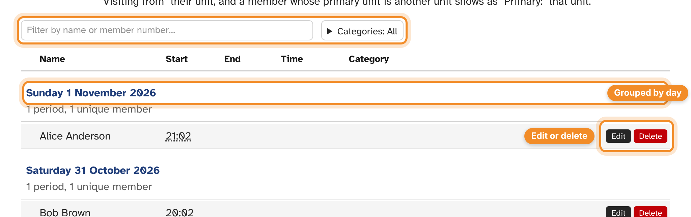
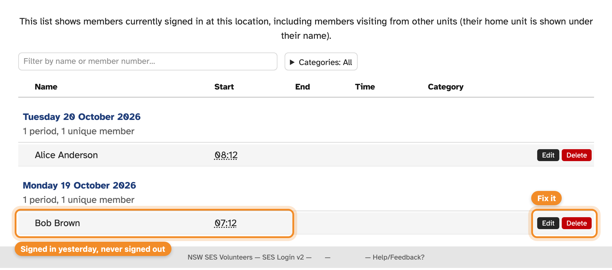
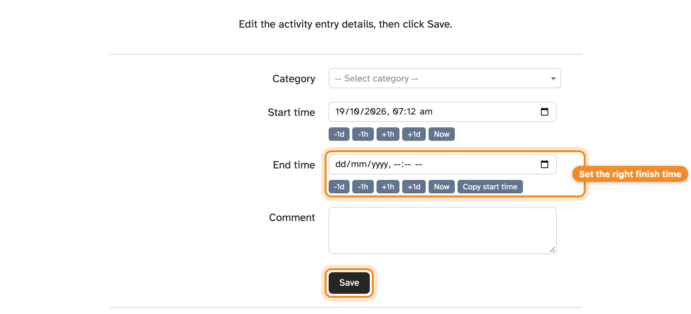

Each time a member signs in and out, SESLogin records an **activity entry**
(sometimes called a period): who, when, for how long, and the category they
chose. The **Activity** menu is where you check and correct them.

## Previous Periods

**Activity** opens on **Previous Periods**: every entry at your unit, newest
first, grouped by day with a count of entries and members.

- It includes visitors, members who don't belong to your unit. A visitor shows
  as "Visiting from" their unit under their name. A member of your unit whose
  primary unit is elsewhere shows as "Primary:" that unit, and is not a visitor.
- Filter by name or SES ID with the box at the top, or by category with
  **Categories**.
- Scroll down to load older entries.

## Seeing which kiosk was used

Each entry remembers the kiosk the member signed in at and the one they signed
out at. Times that came from a kiosk have a dotted underline: hover over one, or
tap it on a touchscreen, to see the kiosk's name.

Entries added with **New Period** have no kiosk, and neither does a finish time
an admin set for someone who never signed out. Editing an entry keeps the kiosks
it already had.

## Who is signed in now

**Incomplete Periods** lists everyone who is signed in right now, with when they
arrived. Someone still on the list long after they've gone home probably forgot
to sign out — [fix their entry](#correcting-an-entry).

## Correcting an entry

Admins can correct any entry, including one that's still open.

1. Press **Edit** next to the entry.
2. Change the **Category**, **Start time** or **End time**. The buttons under each
   time (**-1d**, **-1h**, **+1h**, **+1d**, **Now**) nudge it, and **Copy start
   time** copies the start into the end so you only have to change the hour.
3. Add a **Comment** if it helps explain the change.
4. Press **Save**.

You'll be warned if the end time is before the start, or more than 24 hours
after it.

Every change is recorded in the [audit log](audit-log.md). If your unit exports to
NITC, the change is sent to the NITC too — see [NITC export](nitc.md).

## Adding time by hand

If a member forgot to use the kiosk altogether, record their time with **New
Period**: choose the **Member** and **Category**, set the start and end times,
and press **Save**.

## Deleting an entry

Press **Delete** next to an entry that shouldn't exist — a duplicate, or a test
sign-in. You'll be asked to confirm.

## Guests

If a kiosk has the **Guests** option on (see
[kiosk settings](kiosks.md#options)), visitors without an SES membership can sign
in by name. Their entries appear in the activity list with the name they gave.
You can edit a guest's name and times, but guests have no category and aren't
counted in member reports.
