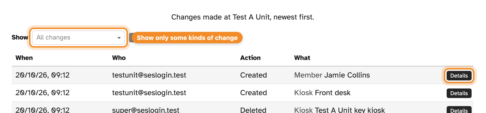

The **Audit log** records every change made at your unit: entries added, edited
or deleted, members added or changed, kiosks set up or removed, and so on —
newest first. Admin and Read only users can both see it.

## Reading the log

Each row shows **When** the change happened, **Who** made it, the **Action**
(such as Created, Updated or Deleted) and **What** it was made to. Press
**Details** to see exactly which fields changed, from what to what.

"Who" is usually a person's email address. A change a member made in the Tally
app shows the member's name instead, marked "Member, in Tally". Changes made
automatically show what made them instead — for example, the daily update of
members from SES.

## Filtering

Use **Show** to pick one or more kinds of change — for example, only activity
entries, or only kiosks — and press **Apply**.

> [!NOTE]
> Secrets such as kiosk keys are never shown; a change to one appears as
> "[redacted]".
