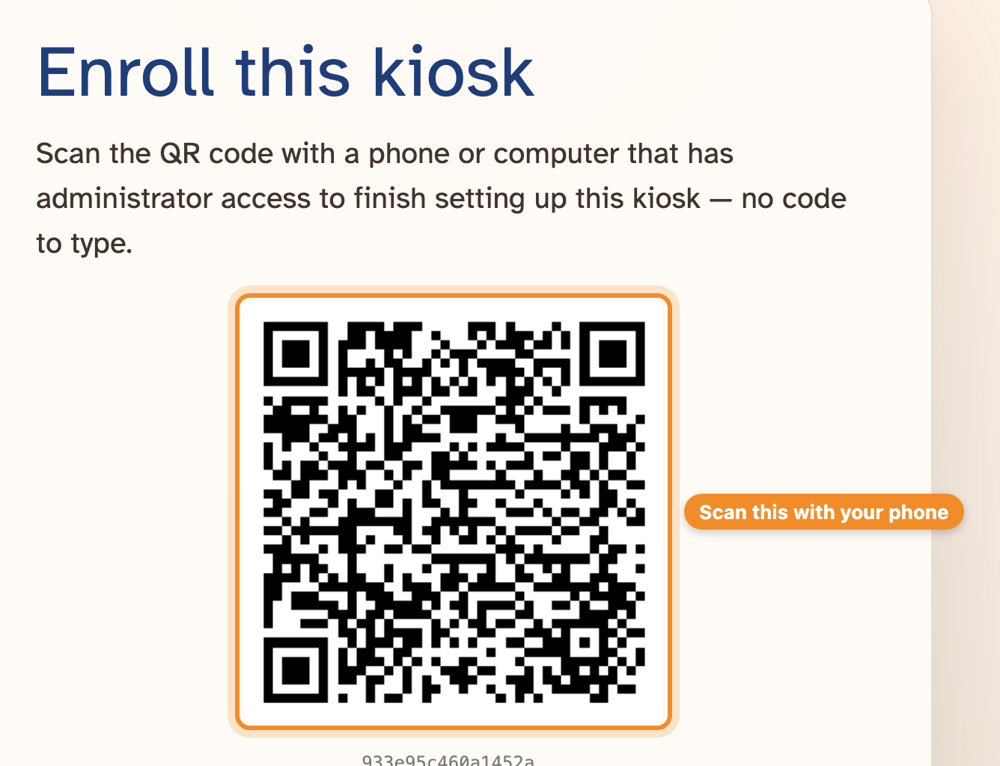
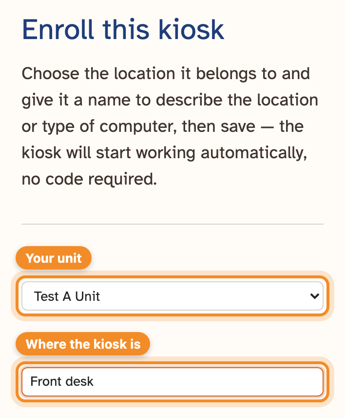
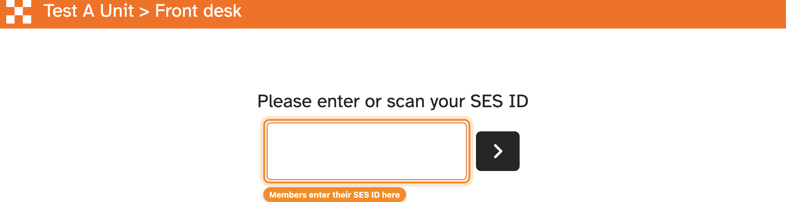
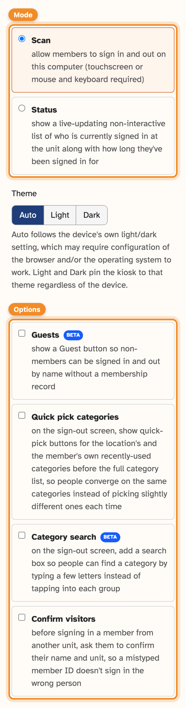
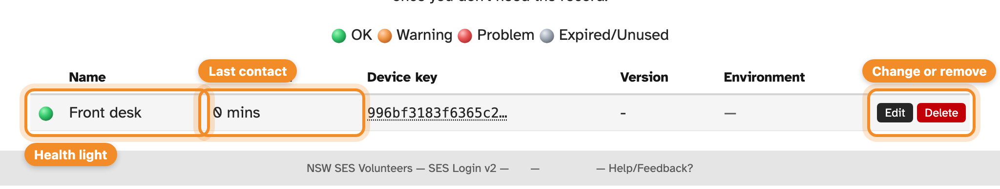

A **kiosk** is a computer or tablet at your unit where members sign in and out.
You can have as many as you like: members can sign in at one and out at another.

Setting one up takes about a minute and needs your phone (or any device you can
sign in to the admin dashboard on).

## What you need

- A computer or tablet with an up-to-date browser such as Chrome, Edge or
  Safari.
- A touchscreen, or a mouse and keyboard. A number-pad-only keyboard works well.
- A reasonably steady internet connection. Kiosks cope with brief drop-outs, but
  a flaky connection slows sign-ins down.
- Ideally, a computer that stays on, doesn't lock itself when idle, and opens the
  SESLogin kiosk page by itself after a power cut. See
  [Keeping a kiosk running](#keeping-a-kiosk-running).

## Setting up a kiosk

1. On the kiosk computer, open SESLogin and choose **Kiosk**. It shows a QR
   code.

   

2. Scan the QR code with your phone's camera. It opens the setup page for this
   kiosk — sign in if you're asked to.
3. Choose your unit under **Location**, and give the kiosk a **Name** that says
   where it is, such as "Front desk" or "Training room".

   

4. Check the [settings](#kiosk-settings) — the defaults suit most units.
5. Press **Save**.

Within a few seconds the kiosk switches over by itself and shows
"Please enter or scan your SES ID". It's ready to use.

> [!TIP]
> Bookmark the kiosk page in the kiosk's browser, or set it as the home page,
> so it's easy to get back to.

## Kiosk settings

You choose these when you set a kiosk up, and can change them later with
**Edit** on the **Kiosks** page. The defaults suit most units.

### Mode

- **Scan** (usual): members sign in and out on this computer.
- **Status**: the screen becomes a live list of who is signed in at the unit,
  and how long for. Nobody can sign in on it — useful on a wall screen.

### Options

- **Guests**: adds a **Guest** button so visitors without an SES membership
  can sign in and out by name. Guests appear in your activity, but not in
  member reports.
- **Quick pick categories**: when a member signs out, shows buttons for the
  categories your unit and that member have used recently, before the full list.
  It saves time, and keeps everyone choosing the same categories.
- **Category search**: adds a **Search categories** box to the sign-out screen,
  so members can type a few letters to find a category instead of tapping into
  each group. Each result shows its group, such as Training > Storm & Water:
  Ground. Training and Workshop - Participant come first and Workshop - Trainer,
  Trainer and Assessor last, so people who are unsure aren't steered into the
  instructor groups. On a touch kiosk, tapping the box brings up the keyboard.
- **Confirm visitors**: before signing in a member from another unit, the kiosk
  shows their name and home unit and asks "Are you …?". Most mistyped SES IDs
  belong to someone at another unit, so this stops people signing in as the
  wrong person. Members of your own unit are signed in straight away, as usual.

### Other settings

- **Theme**: Auto follows the device's light or dark setting; Light and Dark
  fix it.
- **Interface**: Auto works for most kiosks. Choose **Touch** to show an
  on-screen number pad, or **Mouse & keyboard** to never show one, if the
  automatic choice gets it wrong.
- **Who's here**: shows the list of who's signed in on the kiosk's own screen —
  behind a **Button**, or **Always visible** beside the sign-in box.
  **Visible + Sign out** also puts a **Sign out** button next to each
  member, so the last person to leave can sign out anyone who forgot. It runs the
  usual sign-out steps, so someone still picks the category and checks the times.
- **Config Editor**: **Basic** shows the settings above. **Advanced** edits the
  same settings as raw text; you shouldn't need it.

## How members use a kiosk

1. A member types or scans their SES ID and presses enter (or the arrow). They're
   signed in.
2. When they leave, they enter their SES ID again. They pick a **category** for
   what they were doing, can adjust their start and finish times if needed, and
   are signed out.

If someone has been signed in for more than 12 hours, the kiosk asks whether they
forgot to sign out. Choosing **Yeah** back-dates the sign-out to one hour after
they arrived, and they can then correct the times before signing back in.

Members from other units can sign in at your kiosks. Their time appears in your
unit's activity, with their home unit shown under their name. With
[Confirm visitors](#options) turned on, the kiosk asks them to confirm who they
are first.

The [kiosk guide](../kiosk/quick-start.md) explains all this for members. Point
your unit at it: it's at **/guide/kiosk** on the SESLogin site, and the home
page's **Guide** button leads there.

## The Kiosks page

**Kiosks** in the menu lists every kiosk at your unit:

- the coloured light shows its health — **OK**, **Warning**, **Problem**, or
  grey for **Expired/Unused**;
- **Last contact** is how long ago the kiosk last checked in;
- **Edit** renames a kiosk or changes its [settings](#kiosk-settings);
- **Delete** removes it, and the computer stops working as a kiosk.

Only Admins can add, change or delete kiosks.

### When a kiosk expires

A kiosk that hasn't been in touch for **two weeks** expires — usually because
the computer was switched off or the browser closed. To bring it back, switch the
kiosk on and wait for it to show its QR code, then press **Reactivate** next to
it on the **Kiosks** page.

You have **two more weeks** to reactivate it. After that the kiosk is retired: it
disappears from the **Kiosks** page (the [audit log](audit-log.md) records it),
and the computer has to be [set up again](#setting-up-a-kiosk). Very old kiosks
set up with a six-digit setup code (rather than a QR code) can't be reactivated
at all — set them up again instead.

### Replaced kiosks

A kiosk marked **Replaced** belongs to a computer that has since been set up
again — possibly at another unit — so it's now a different entry. The old entry
stops working and stays only so you can see what happened. Delete it once you
don't need it, or leave it: it's removed automatically after two weeks.

## Keeping a kiosk running

- Set the computer not to sleep, lock or log out when idle, and to switch back on
  after a power cut.
- Make the browser open the SESLogin kiosk page when the computer starts.
- On Windows, Chrome has a kiosk mode that runs full-screen with no browser
  controls — [this guide](https://superuser.com/a/1363172) explains how.
- On a Raspberry Pi, [FullPageOS](https://github.com/guysoft/FullPageOS/) boots
  straight into a full-screen browser.
