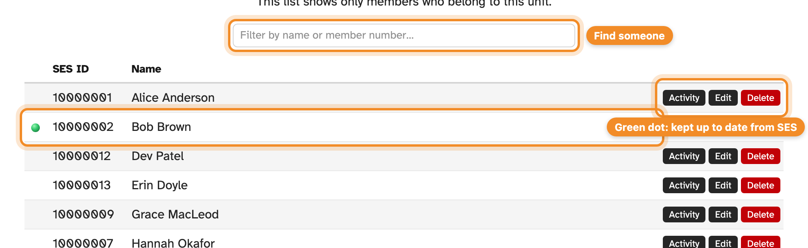
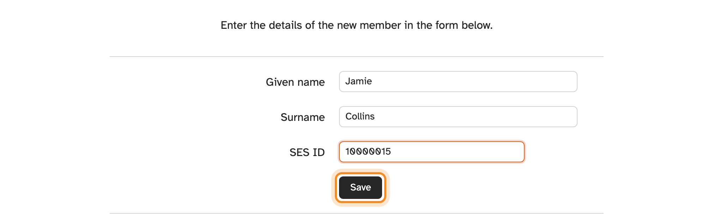

**Members** lists everyone who belongs to your unit, with their SES ID. Members
from other units can still sign in at your kiosks — they just aren't listed here.

## Finding a member

Type part of a name or SES ID into the filter at the top of the list.

## Members kept up to date from SES

For most units, SESLogin copies your members in from SES records automatically,
once a day. These members have a **green dot**:

- their name and SES ID come from SES, so you can't edit or delete them here —
  correct them in SES and the change arrives within a day;
- new members appear within a day of being added in SES;
- members who leave your unit in SES are removed from SESLogin automatically —
  see [below](#when-members-leave-your-unit).

The top of the member list shows **Last successful member sync**. If it's more
than an hour ago and you've just changed something in SES, an Admin can press
**Sync now** to fetch the changes straight away rather than waiting for the
daily update. **Sync now** refreshes the member list only. Members' email
addresses, which reminders are sent to, come from the SES contact directory,
which SESLogin reads once a day, early each morning.

## A member's details

Press **Details** next to a member with a green dot to open a read-only panel
with what SES holds about them. Everyone with access to your unit can open it,
including Read only users. Members you [added by hand](#adding-a-member) have
no **Details** button, because there is nothing from SES to show.

The panel shows:

- their name, and the name they prefer to be called if SES has one;
- their SES ID and member number;
- their email address, mobile number and any other phone numbers, with what
  each number is used for. Tap an email address or number to start a message or
  call;
- their **qualifications** (SES capability tags), such as first aid or
  chainsaw operation. Hover over one to see its description;
- their **units**: every unit, cluster or team they are assigned to in SES, with
  their membership type, ranks, roles and positions. Their main unit is marked
  **Primary**.

Anything SES doesn't have is left out, or shown as "None recorded". You can't
change any of it here. Correct it in SES and the change arrives with the next
update: contact details and units are refreshed once a day, early each morning,
and qualifications come with the daily member update.

> [!NOTE]
> These are personal details. Only people who can see your unit can open the
> panel, and kiosks never show them.

## Your unit's details

Next to **Last successful member sync** at the top of the list, press **Unit
details** to see what SES holds about your unit: its SES code and ID, its
zone, location on a map, street and postal addresses, contact email and phone, and
rescue accreditations with their status. Like the member panel it is read-only,
and it is refreshed once a day.

## When members leave your unit

When someone no longer appears in your unit's list in SES, SESLogin doesn't
remove them straight away, because they may only be moving to another unit, or
SES may be briefly out of step.

1. **They're marked.** At the next daily update, their green dot turns
   **orange**. Hover over it to see "Missing from SES since… — pending
   deletion". Their edit page shows the same warning.
2. **They get a week's grace.** If they reappear in SES during that time, at your
   unit or any other, the mark is cleared. Members who transfer simply move to
   their new unit, history and all.
3. **Then they're removed.** If they're still missing from SES after about a
   week, they're removed from your member list automatically. The
   [audit log](audit-log.md) records it as done by the member sync.

Removing a member never removes their past activity: their hours stay in your
activity list and reports. If they're added back in SES later, the next update
brings them back, with their history.

> [!IMPORTANT]
> Members you [added by hand](#adding-a-member) (no green dot) are never removed
> automatically. Only members that came from SES can go missing from it.

### Safeguards

- If the update hasn't been working for your unit lately, nobody is removed
  until it has run successfully again. A unit coming back from an outage won't
  lose members it simply hadn't heard about.
- If an unusually large share of your unit would be removed at once, which
  usually means a problem at SES rather than a mass departure, the update stops
  for your unit without changing anything, and the SESLogin maintainers check it
  by hand.

### Someone is marked by mistake

If a current member has an orange dot, check their record in SES: they may have
been moved to another unit, or their membership may have lapsed. Fix it in SES
before the week is up and the mark clears at the next update. If SES looks right,
contact support (see [Roles and access](roles-and-access.md#getting-access)).

## Seeing a member's history

Press **Activity** next to a member to see every time they've signed in and out,
at any unit.

## Adding a member

Admins can add someone who isn't in the list — for example, while their SES
record is still being set up.

1. Open **Members** and choose **New**.
2. Enter their **Given name**, **Surname** and **SES ID**.
3. Press **Save**.

They can sign in at any kiosk straight away.

> [!TIP]
> Add yourself first if you're not already listed, so you can test your kiosk.

## Changing or removing a member

For members without a green dot, Admins can press **Edit** to correct their
details, or **Delete** to remove them. Deleting a member doesn't delete their
past activity.
