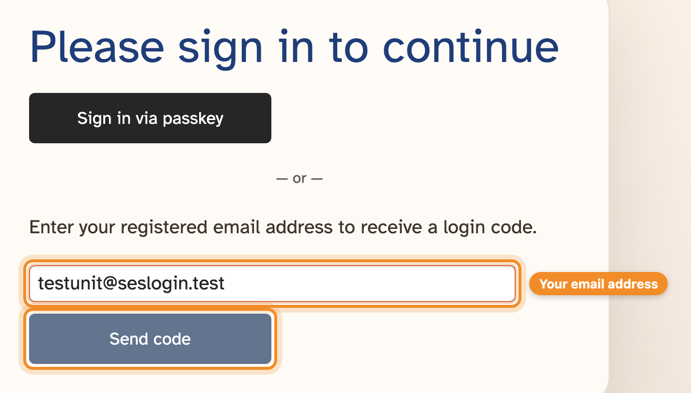
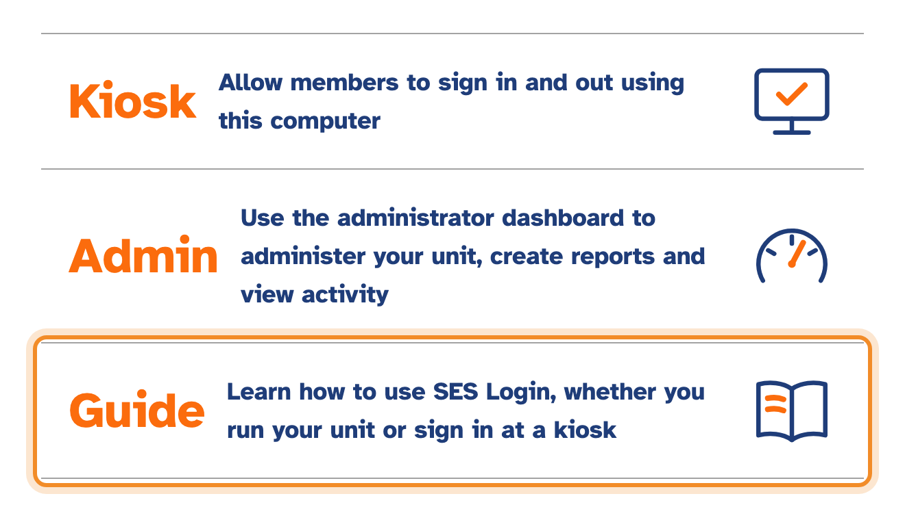
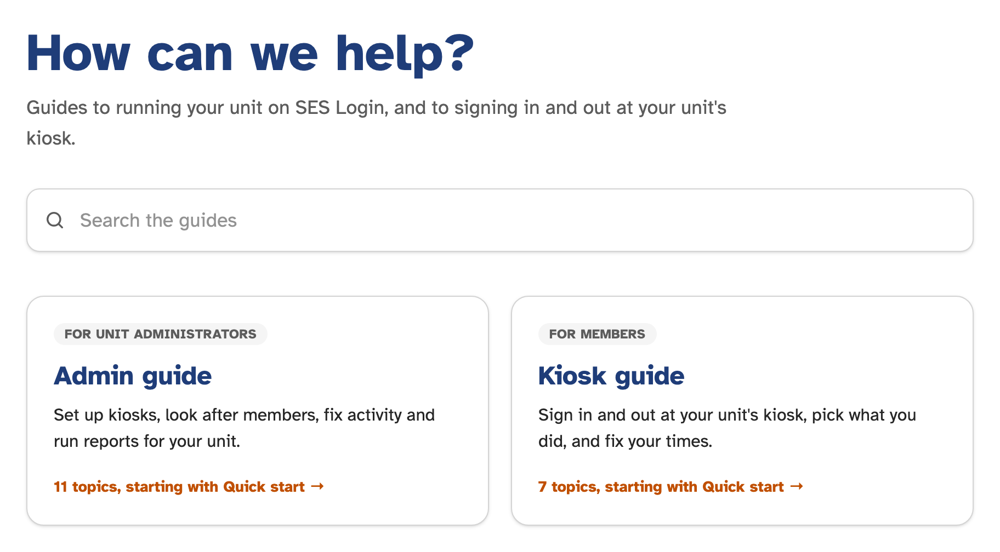
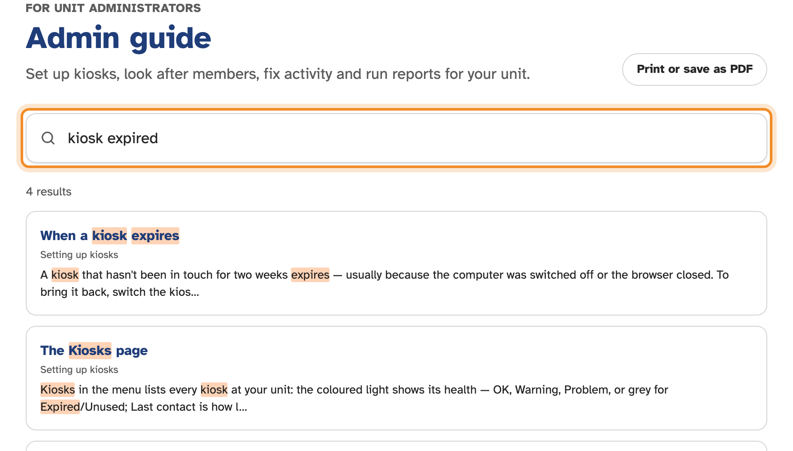
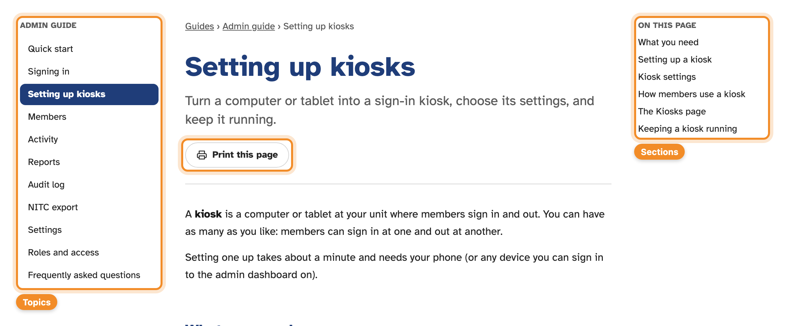

SES Login records when your members sign in and out, and what they were doing.
Members sign in at a **kiosk** — a computer or tablet at your unit — and you
manage everything else from the **admin dashboard**.

This page gets you from your first sign-in to a working kiosk and your first
report. Each step links to the full topic if you want more.

## 1. Sign in

1. Open SES Login and choose **Admin**.
2. Enter the email address your account was set up with and press **Send code**.
3. Check your email for a six-digit code, enter it, and press **Verify code**.

You'll be offered a **passkey** so that next time you can sign in with Face ID,
a fingerprint or your device PIN instead of waiting for an email. It's worth
setting one up. See [Signing in](signing-in.md).

> [!NOTE]
> Don't have an account yet? Ask an existing administrator at your unit, or
> contact support — see [Roles and access](roles-and-access.md#getting-access).

## 2. Check your members

Open **Members**. Most units' members are copied in automatically from SES
records each day, so your list is probably already filled in. Members kept up
to date this way have a green dot next to them.

If someone is missing, choose **New** and add them with their name and SES ID.
See [Members](members.md).

## 3. Set up a kiosk

You need a computer or tablet with a web browser, at your unit.

1. On that computer, open SES Login and choose **Kiosk**. It shows a QR code.
2. Scan the QR code with your phone's camera and sign in if asked.
3. Choose your unit, give the kiosk a name (such as "Front desk"), and press
   **Save**.

Within a few seconds the kiosk switches over and is ready to use. Try it: type
your own SES ID and press enter to sign in, then do it again to sign out.

See [Setting up kiosks](kiosks.md) for the settings, and for keeping a kiosk
running long-term.

## 4. Check on activity

**Activity** lists every sign-in at your unit, newest first. **Incomplete
Periods** shows who is signed in right now — and anyone who forgot to sign
out, which you can fix with **Edit**. See [Activity](activity.md).

## 5. Run a report

- **Activity → Totals** shows hours for each member and each category over any
  dates you choose.
- **Reports** downloads every sign-in for a date range as a spreadsheet (CSV or
  Excel).

See [Reports](reports.md) for these and the other views, like the attendance
heatmap.

## Using this guide

This guide is on the SES Login site at **/guide/admin**, and anyone can read it
without signing in. Get there from **Guide** on the home page, or from **User
guide** at the right-hand end of the admin menu, which opens it in a new tab.

Search from the top of any guide page. **Print or save as PDF**, on the guide's
contents page, puts the whole guide on one page.

On each topic page, the list down the side jumps between topics, **On this page**
jumps to a section, and **Print this page** prints just that topic.

Members have their own [kiosk guide](../kiosk/quick-start.md), for signing in and
out.

## Where next

- Get a summary of each day's activity by email: [Settings](settings.md#daily-email-summary).
- See who changed what: [Audit log](audit-log.md).
- Stuck? Use **Help/Feedback?** at the bottom of any admin page, or see the
  [FAQ](faq.md).
