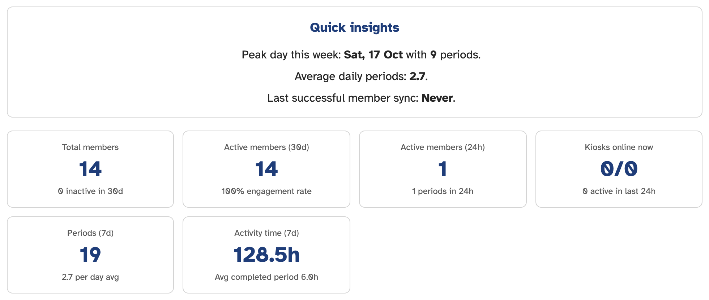
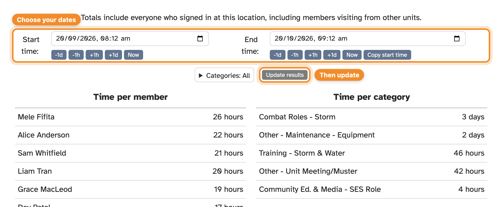
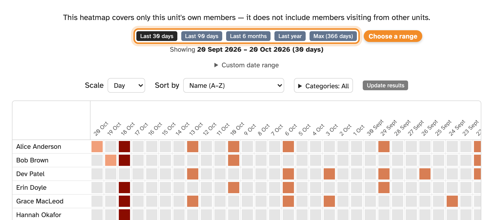
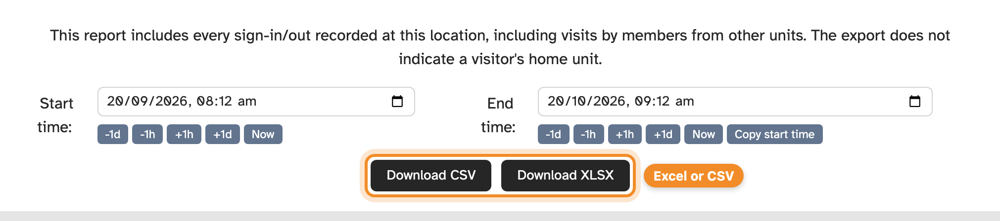

SES Login has several views of your unit's activity. All of them work for both
Admin and Read only users.

## The dashboard

**Home** gives a snapshot: how many members you have and how many have been
active, which kiosks are online, entries and hours over the last week, a chart of
entries per day, and your most-used categories.

## Choosing dates

The reports below share the same date controls. Set the **Start time** and **End
time** — type a date, or nudge it with **-1d**, **-1h**, **+1h**, **+1d** and
**Now** — then press **Update results**.

## Totals

**Activity → Totals** shows the hours for each member and for each category over
your chosen dates. Use **Categories** to count only some categories, for example
just training.

## Breakdown and Daily Breakdown

- **Activity → Breakdown** lists each member's hours split by category.
- **Activity → Daily Breakdown** groups activity by day; open a day to see who
  attended and for how long.

## Heatmap

**Activity → Heatmap** shows a grid of members against days, coloured by how
active each member was. It makes busy weeks and quiet members easy to spot.

- Choose a range with **Last 30 days**, **Last 90 days**, **Last 6 months**,
  **Last year** or **Max**, or set your own with **Custom date range**.
- **Scale** groups by **Day**, **Week** or **Month**.
- **Sort by** name, most or least active, or most or least recently active.

The heatmap covers your unit's own members only, not visitors.

## Last Seen

**Activity → Last Seen** lists your members by when they last signed in, at any
unit. Sort by **Least recent** to find members you haven't seen for a while.

## Downloading a spreadsheet

**Reports** downloads every sign-in at your unit between two times, for working
with in Excel or another spreadsheet.

1. Open **Reports**.
2. Set the **Start time** and **End time**.
3. Press **Download XLSX** (Excel) or **Download CSV**.

Each row is one entry: the member, category, start and end times, how long it
was, any comment, and the kiosks they signed in and out at. The download includes
members visiting from other units, but doesn't say which unit they're from.

## Daily email

To have a summary of each day's activity emailed to you, see
[Daily email summary](settings.md#daily-email-summary).
