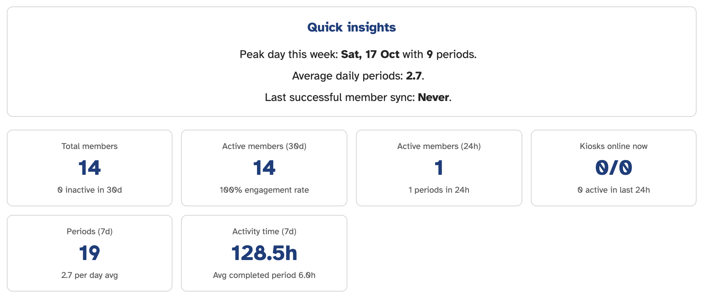
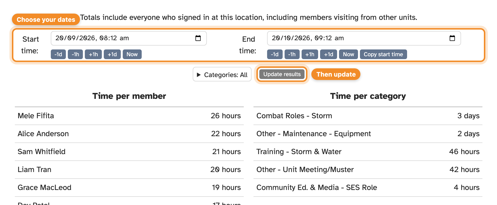
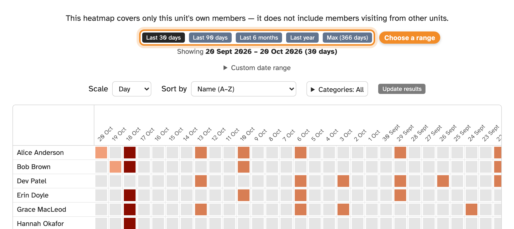
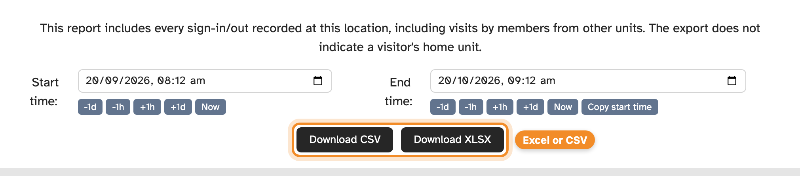

SESLogin has several views of your unit's activity. All of them work for both
Admin and Read only users.

## The dashboard

**Home** gives a snapshot: how many members you have (including members whose primary
unit is elsewhere but who also volunteer at yours) and how many have been
active, which kiosks are online, entries and hours over the last week, a chart of
entries per day, and your most-used categories.

## Choosing dates

The reports below share the same date controls. Set the **Start time** and **End
time** — type a date, or nudge it with **-1d**, **-1h**, **+1h**, **+1d** and
**Now** — then press **Update results**.

## Totals

**Activity → Totals** shows the hours for each member and for each category over
your chosen dates. Use **Categories** to count only some categories, for example
just training.

## Breakdown and Daily Breakdown

- **Activity → Breakdown** lists each member's hours split by category.
- **Activity → Daily Breakdown** groups activity by day; open a day to see who
  attended and for how long.

## Heatmap

**Activity → Heatmap** shows a grid of members against days, coloured by how
active each member was. It makes busy weeks and quiet members easy to spot.

- Choose a range with **Last 30 days**, **Last 90 days**, **Last 6 months**,
  **Last year** or **Max**, or set your own with **Custom date range**.
- **Scale** groups by **Day**, **Week** or **Month**.
- **Sort by** name, most or least active, or most or least recently active.

The heatmap covers your unit's own members only, not visitors.

## Last Seen

**Activity → Last Seen** lists your members by when they last signed in, at any
unit. Sort by **Least recent** to find members you haven't seen for a while.

## Downloading a spreadsheet

**Reports** downloads every sign-in at your unit between two times, for working
with in Excel or another spreadsheet.

1. Open **Reports**.
2. Set the **Start time** and **End time**.
3. Press **Download XLSX** (Excel) or **Download CSV**.

Each row is one entry: the member, category, start and end times, how long it
was, any comment, and the kiosks they signed in and out at. The download includes
visitors (members who don't belong to your unit), but doesn't say which unit they're from.

## Badge Report

If your unit has badges turned on, **Reports → Badge Report** shows your unit's
trophy cabinet and the members who have earned badges at your unit.

### Perpetual trophies

The unit has twelve trophies, and each one has one holder at a time. Whoever beats
the holder takes it from them. Each card shows who holds the trophy, their score and
when they took it. Open **How to win it** to see exactly what it takes and who held
it before.

- Most trophies are worked out overnight, from the last 30 to 90 days of sign-ins.
  The Chain counts a member's current weekly streak.
- The Boomerang (the longest gap between sign-ins at your unit) and The Odometer
  (the furthest one of your members has signed in from their own units) can change
  hands as soon as a member signs in. A claim counts for a year.
- Only your unit's own members can hold its trophies, including members whose primary
  unit is elsewhere. Visitors can't.
- Ties go to the holder. A holder who stops coming in keeps the trophy until someone
  beats their score.
- If a member leaves your unit, their trophies pass to whoever is next. If you delete
  or change the sign-in a Boomerang or Odometer claim rested on, the trophy goes back
  to the best claim that still stands.

The kiosk guide lists [every trophy and how to win it](../kiosk/badges.md#unit-trophies).

### Members' badges

The table lists each member with a badge at your unit: how many they have, how many
they earned in the last 7 days, and their latest. Select a name to see all of their
badges.

### Congratulations emails

SESLogin can email your members about their wins. It's a **unit setting**, off until
it's turned on. Unit settings are managed by the SESLogin maintainers, so ask them to
turn it on or off: use **Help/Feedback?** at the bottom of any admin page, or email
[support@seslogin.com](mailto:support@seslogin.com).

- Each evening at about 7 pm, a member who earned a badge or took a trophy that day
  gets one email showing each badge and trophy and how they won it. Most trophies,
  and some badges, are worked out overnight, so they're in the next evening's email.
- It goes to the email address SES holds for them. Members with no email address in
  SES don't get one.
- It covers all of your members, including those whose primary unit is elsewhere. A
  member is emailed if any of their units has it turned on.
- There is no unsubscribe link, and turning it off stops the emails for the whole unit.

The kiosk guide tells members [what the email covers](../kiosk/badges.md#congratulations-emails).

## Daily email

To have a summary of each day's activity emailed to you, see
[Daily email summary](settings.md#daily-email-summary).
