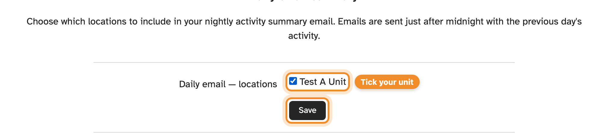

**Settings** holds your own preferences. They apply to you only, not to other
administrators at your unit.

## Passkeys

Add, rename or remove the passkeys you sign in with. See
[Passkeys](signing-in.md#passkeys).

## Daily email summary

Get an email each day summarising the previous day's activity at your unit.

1. Open **Settings → Daily Email Summary**.
2. Tick each unit you want included.
3. Press **Save**.

Emails are sent just after midnight. Untick a unit and save to stop them.

## Daily membership changes

Get a morning email listing what changed in your unit's membership the previous
day (Sydney time). It is only sent on days when something changed.

1. Open **Settings → Daily Membership Changes**.
2. Tick each unit you want included.
3. Press **Save**.

Untick a unit and save to stop them. Admins and Read only users can both turn it
on, for any unit they can see. The email arrives around 6:30 am.

For each unit it lists:

- **Joined**: new members, members restored after being removed,
  members who moved in from another unit, and members added as a secondary
  unit.
- **Left**: members who were deleted, moved to another unit, or
  were removed as a secondary unit.
- **Flagged as missing from SES**: members that the daily member sync no longer finds
  in the SES member list. They are not removed straight away. If SES doesn't
  list them again within 7 days, they are deleted and appear under **Left**. A member who transfers to another unit is picked up there before
  then and is never deleted.
- **Listed in SES again**: members who were flagged as missing and are listed
  again.
- **Member details changed**: names, member number, capability tags, and
  unit assignments or roles. Changes to a member's email address, mobile or
  phone numbers are shown as **changed** only, without the old or new values.
- **Unit details changed**: changes to the unit's own details.

Each change says where it came from: **Member sync**, **Directory sync**,
**Location sync**, or the email address of the administrator who made it.

## Activity display

Some categories are marked as **virtual**. Tick **Disaggregate virtual periods**
on **Settings → Activity Display** to show virtual and non-virtual time
separately in the dashboard and activity views, then press **Save**.

## Connected apps

When an app or AI tool (such as Claude) asks to connect to your SESLogin
account, SESLogin shows you a page asking whether to approve it. For an AI
tool, the page names the website it will send you back to. For one of
SESLogin's own apps, it says so instead. Only approve a request you started
yourself.

Once approved, the app appears under **Settings → Connected Apps**. The
**Redirects to** column shows the website it sends you back to, or **SESLogin
app** for one of SESLogin's own apps. A connected app can act as you, with
your permissions. Disconnect anything you no longer use or don't recognise.
