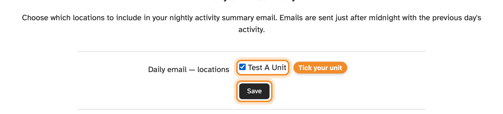

**Settings** holds your own preferences. They apply to you only, not to other
administrators at your unit.

## Passkeys

Add, rename or remove the passkeys you sign in with. See
[Passkeys](signing-in.md#passkeys).

## Daily email summary

Get an email each day summarising the previous day's activity at your unit.

1. Open **Settings → Daily Email Summary**.
2. Tick each unit you want included.
3. Press **Save**.

Emails are sent just after midnight. Untick a unit and save to stop them.

## Activity display

Some categories are marked as **virtual**. Tick **Disaggregate virtual periods**
on **Settings → Activity Display** to show virtual and non-virtual time
separately in the dashboard and activity views, then press **Save**.

## Connected apps

When an app or AI tool (such as Claude) asks to connect to your SESLogin
account, SESLogin shows you a page asking whether to approve it. For an AI
tool, the page names the website it will send you back to. For one of
SESLogin's own apps, it says so instead. Only approve a request you started
yourself.

Once approved, the app appears under **Settings → Connected Apps**. The
**Redirects to** column shows the website it sends you back to, or **SESLogin
app** for one of SESLogin's own apps. A connected app can act as you, with
your permissions. Disconnect anything you no longer use or don't recognise.
