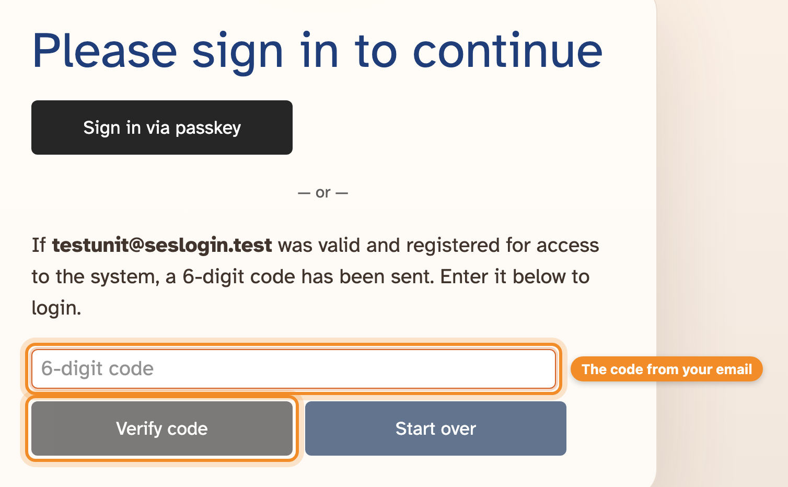
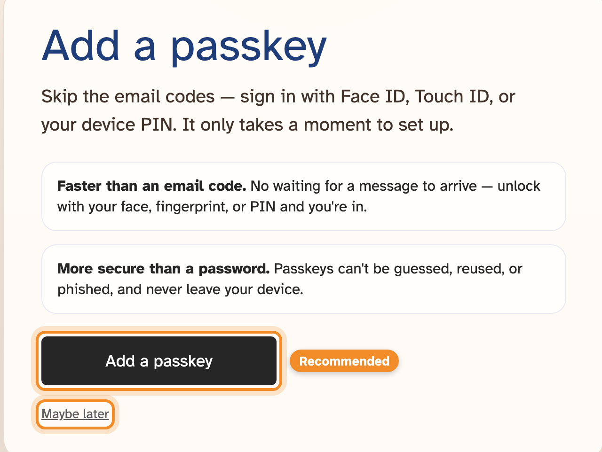

There are no passwords in SES Login. You sign in with a code sent to your email,
or with a passkey saved on your phone or computer.

## Signing in with an email code

1. Open SES Login and choose **Admin**.
2. Enter your email address and press **Send code**.
3. Enter the six-digit code from the email and press **Verify code**.

The code expires after 10 minutes. If it doesn't arrive, check your junk mail,
make sure you typed the address your account was set up with, and press
**Start over** to try again.

> [!NOTE]
> For security, the screen says a code "has been sent" whether or not the
> address has an account. If you never get one, your account may use a different
> address — ask an administrator at your unit.

## Passkeys

A passkey lets you sign in with Face ID, Touch ID, a fingerprint or your
device PIN instead of an email code. It's faster, and safer than a password:
it can't be guessed or phished, and never leaves your device.

### Adding a passkey

After you sign in with an email code, SES Login offers to add one. Press
**Add a passkey** and follow your device's prompts, or **Maybe later** to skip
(you'll be asked again in a day or so).

You can also add one at any time from **Settings → Passkeys**. You can save up
to 10 — one for each phone or computer you use.

### Signing in with a passkey

On the sign-in screen, press **Sign in via passkey** and confirm with your
face, fingerprint or PIN.

### Removing a passkey

Go to **Settings → Passkeys** and remove the one you no longer need — for
example, from a phone you've replaced.

## Choosing your unit

If you look after more than one unit, you'll be asked to choose one the first
time you sign in. To switch later, click your unit's name in the orange title
bar.

## Signing out

Press **Logout** in the menu. Do this on shared computers — but **never sign out
of a kiosk**; kiosks don't use your sign-in at all (see
[Setting up kiosks](kiosks.md)).
