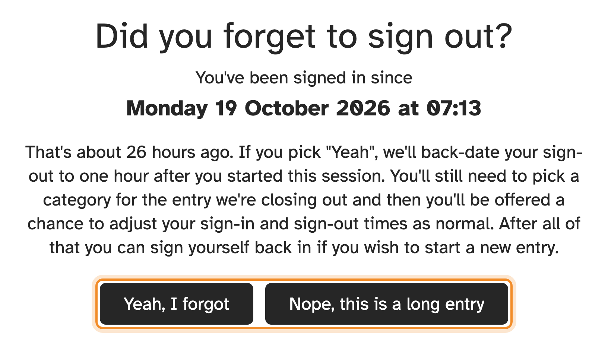

If you've been signed in for more than 12 hours, the kiosk assumes you probably
forgot to sign out last time, and asks.

## "Yeah, I forgot"

The kiosk closes your old visit for you, with a finish time one hour after you
arrived. You then:

1. choose what you did on that visit, as usual;
2. fix the finish time on the **Confirm** screen if you remember when you really
   left, and press **Submit**.

If you're at the unit now, enter your SES ID again to sign in for today.

## "Nope, this is a long entry"

You really have been here all this time, for example on a long job. The kiosk
signs you out as normal, with the full time.

## Already gone home?

If you remember after you've left, you don't need to do anything at the kiosk.
Ask your unit's administrators to fix the entry, or ask whoever's still at the
unit to sign you out from the [Who's here](whos-here.md) list, if your kiosk has
one.

## Getting a "Forgot to sign out?" email

Some units have SESLogin email members who are still signed in long after they
arrived. If yours does, and you've been signed in for about 12 hours, you'll get
an email from no-reply@seslogin.com with the subject **Forgot to sign out at
SES?**. It's sent to the email address SES holds for you.

The email says where and when you signed in, and has a link to a page where you
enter the time you finished and pick what you did, then press **Save**. That
signs you out. The link:

- only opens that one entry, and needs no sign-in;
- works for 48 hours, and you can use it again in that time to correct a
  mistake;
- can't make the entry longer than 24 hours.

If you don't fix the entry, you may get a second email about a day after you
signed in and a last one after about two days. After that you won't get any
more emails about that entry. SESLogin never sends you more than one of these
emails in 12 hours, even if you have more than one entry left open, and only
sends them during the day, between about 7 am and 9 pm.

Once the entry has a finish time, the emails stop. That's true whether you use
the link, sign out at the kiosk, or an administrator fixes it for you. If you
really are still at the unit, for example on a long job, you can ignore the
email and sign out as usual when you leave.
