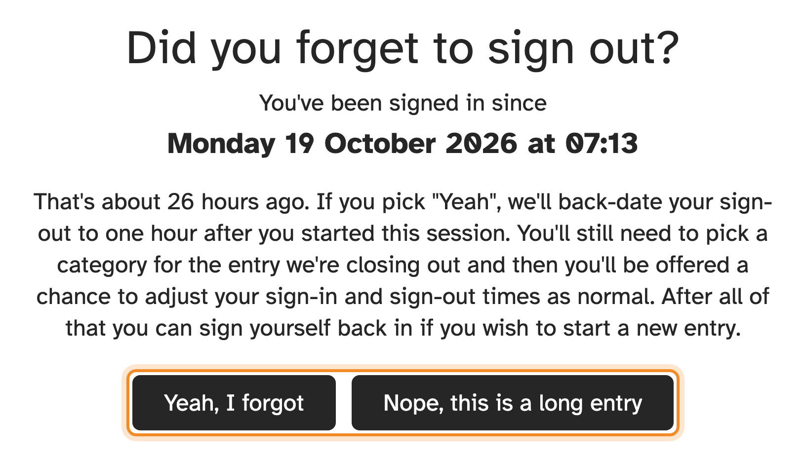

If you've been signed in for more than 12 hours, the kiosk assumes you probably
forgot to sign out last time, and asks.

## "Yeah, I forgot"

The kiosk closes your old visit for you, with a finish time one hour after you
arrived. You then:

1. choose what you did on that visit, as usual;
2. fix the finish time on the **Confirm** screen if you remember when you really
   left, and press **Submit**.

If you're at the unit now, enter your SES ID again to sign in for today.

## "Nope, this is a long entry"

You really have been here all this time, for example on a long job. The kiosk
signs you out as normal, with the full time.

## Already gone home?

If you remember after you've left, you don't need to do anything at the kiosk.
Ask your unit's administrators to fix the entry, or ask whoever's still at the
unit to sign you out from the [Who's here](whos-here.md) list, if your kiosk has
one.
