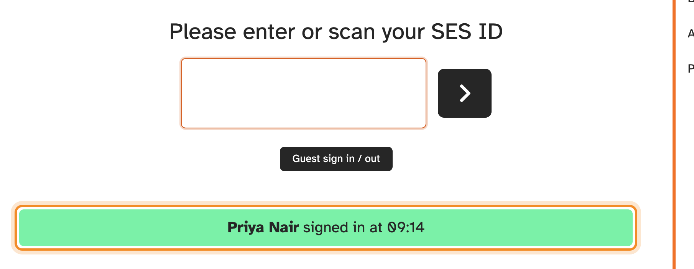
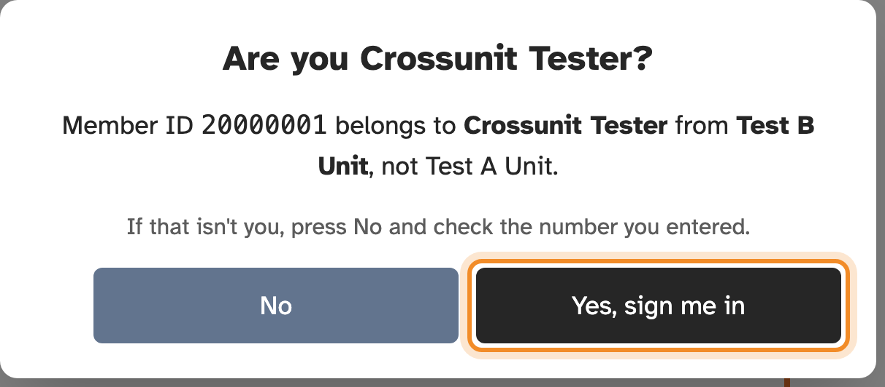

## Entering your SES ID

Type your SES ID (your SES member number) into the box and press **Enter** or the
arrow button. If the kiosk has a card scanner, scanning your card does the same.

On a touchscreen kiosk, tapping the box shows a number pad, so you don't need a
keyboard.

When you're signed in, the kiosk shows your name and the time.

> [!TIP]
> Entering your SES ID **toggles** you: the first time signs you in, the next
> time signs you out. If you're not sure whether you're signed in, check the
> [Who's here](whos-here.md) list if your kiosk shows one.

## "Unknown member ID"

The kiosk doesn't recognise that number. Check you typed it correctly. If it's
right, you may not be on SESLogin's member list yet: ask your unit's
administrators, who can add you.

## Signing in at another unit

You can sign in at any unit's kiosk with the same SES ID. Your time is recorded
at the unit you're visiting, and it also appears in your own history.

Some kiosks check first when you're visiting, meaning the unit isn't one of
yours: they show your name and home unit and ask **Are you …?**. Press **Yes, sign me in** if it's you. If it isn't, press **No**
— you've probably mistyped your SES ID — and enter it again.

If you see this at a unit you belong to, whether it's your home unit or another
you volunteer at, the number you entered belongs to someone else: press **No**
and check it.

## Signing in and out at different kiosks

If your unit has more than one kiosk, you can sign in at one and out at another.
It still counts as one visit.
