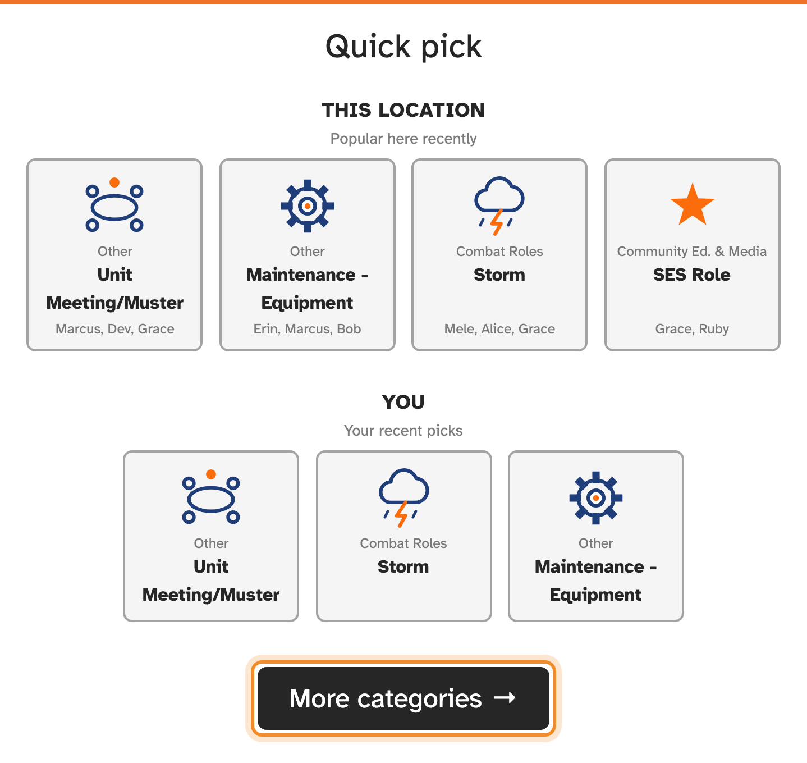
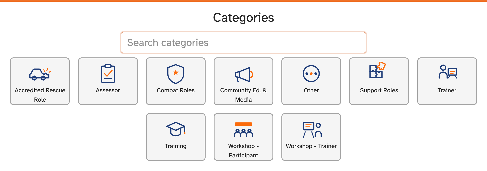
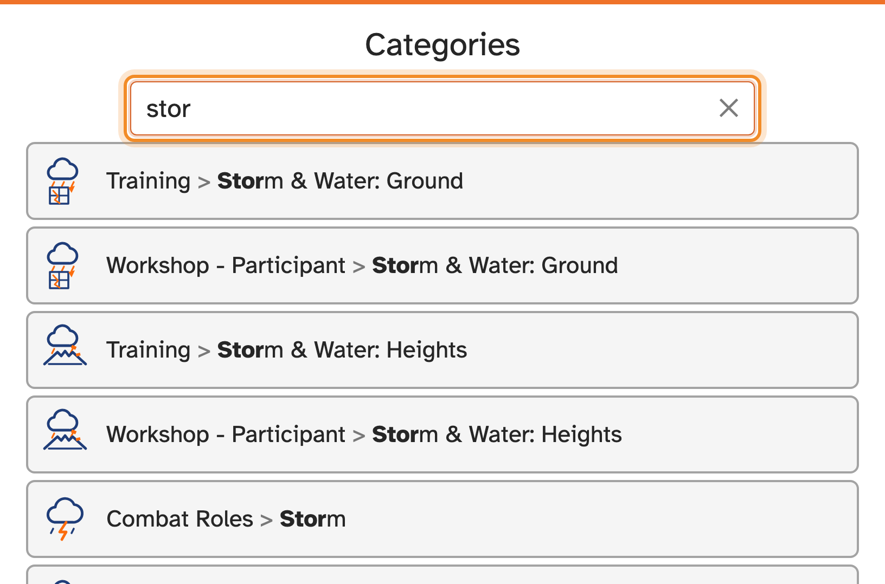
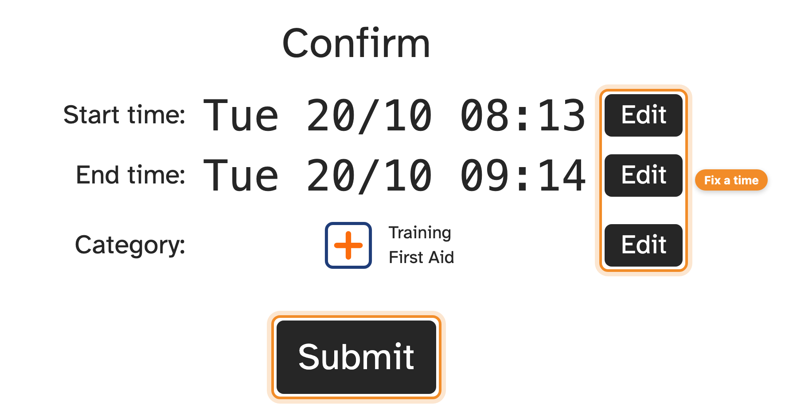

When you leave, enter your **SES ID** again. The kiosk then asks what you spent
your time on, and lets you check the times before you finish.

## Choosing what you did

The kiosk may first offer a **Quick pick**:

- **Popular here recently**: what others at your unit have been choosing, with
  the names of some who chose it.
- **Your recent picks**: what you chose last time.

Tap one to choose it, or press **More categories** to see them all.

**More categories** shows the groups first, such as Training or Other. Tap a
group to see the categories in it, and tap the one that fits. **← Categories**
takes you back to the groups. If your unit has turned on category search, a
search box sits above the groups; see [Searching for a category](#searching-for-a-category).

## Searching for a category

Type the first letters of what you did (at least two) into the **Search
categories** box, such as **stor** for Storm & Water. The matching categories appear as you type, each
with its group, for example Training > Storm & Water: Ground. Tap the one that
fits.

- Acronyms work too: **DOV**, **SWDO**, **OCE**, **FCS**, **VR** and **RCR**, as
  well as the long names they stand for.
- Typing the group helps too: **trainer storm** shows the Workshop - Trainer and
  Trainer ones.
- Inside a group, such as Training, the search looks in that group only. Press
  **All categories**, under the box beside the results, to search everywhere.
- Press the **✕** in the box to clear it. Press **← Categories** to leave a group;
  a search you have typed then looks everywhere.

> [!NOTE]
> The same activity often appears under more than one group, such as Training and
> Trainer, so check the group before you tap.

> [!TIP]
> Pick the category that best describes most of your time. If you're not sure,
> the Quick pick shows what others did at the same session.

## Checking your times

The **Confirm** screen shows your start time, end time and category. If one is
wrong, for example you forgot to sign in when you arrived, press **Edit** next to
it and correct it. Then press **Submit**.

The kiosk then shows "signed out" with your times.

## Changing your mind

Pressed the wrong button, or not actually leaving yet? Press **Cancel sign out**
at the top of the screen. You stay signed in, and nothing is recorded.
